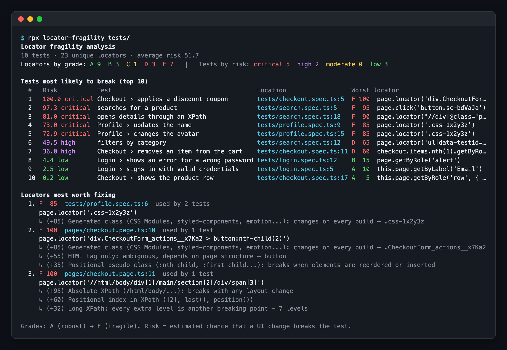
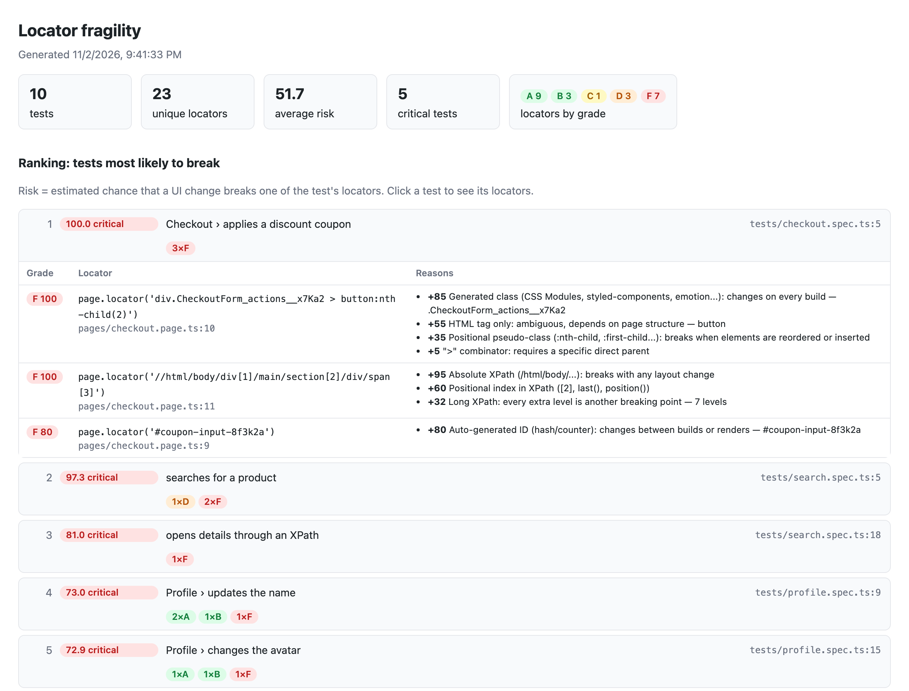

# playwright-locator-analyses

[](https://www.npmjs.com/package/playwright-locator-analyses)
[](https://github.com/laerteneto/playwright-locator-analyses/actions/workflows/ci.yml)
[](https://github.com/laerteneto/playwright-locator-analyses/blob/main/LICENSE)

Locator fragility analysis for Playwright. It works as a **reporter** (runs alongside `playwright test`) and as a **linter/CLI** (runs without executing tests, which makes it a good fit for CI).

Every locator gets a grade from **A (robust)** to **F (fragile)**. Every test then gets a **risk score from 0 to 100**, and the result is a ranking of the tests most likely to break and of the locators most worth fixing.

### Console output

The ranking printed by the CLI and the reporter, run on the [example project](https://github.com/laerteneto/playwright-locator-analyses/tree/main/example):



### HTML report

With `htmlFile` (reporter) or `--html` (CLI), you get a report you can browse. Click a test to see each locator, its grade and the reasons behind it:



## How it works

The analysis is **static**. It uses the TypeScript compiler to read your tests, so it needs no browser and no running app. It follows the code the way a developer would:

- **Page objects and helpers**: `await loginPage.login()` counts the locators used inside `login()`, even when it lives in another file.
- **Properties and getters**: `this.submit = page.locator(...)` in a constructor, `readonly list = page.getByTestId(...)`, `get firstItem() { return ... }`.
- **Hooks**: locators in `beforeEach`/`beforeAll` count for every test in the enclosing `describe`.
- **Chaining**: `cart.items.nth(1).getByRole(...)` inherits the fragility of `items` and adds the `.nth()` penalty.
- **Constants**: `page.locator(SELECTORS.promo)` and template strings are resolved when possible.
- **Legacy API**: `page.click('sel')`, `page.fill('sel', ...)` and `page.$('sel')` are scored too, with an extra penalty.

When it runs as a reporter, it also shows whether each test **failed** or was **flaky** in that run, next to its risk.

## Installation

```bash
pnpm add -D playwright-locator-analyses
# or
npm i -D playwright-locator-analyses
# or
yarn add -D playwright-locator-analyses
```

## Usage as a reporter

```ts
// playwright.config.ts
export default defineConfig({
  reporter: [
    ['list'],
    ['playwright-locator-analyses', {
      htmlFile: 'fragility-report.html',   // optional
      outputFile: 'fragility-report.json', // optional
      top: 10,
      // failOnRisk: 80,                   // mark the run as failed if any test has risk >= 80
    }],
  ],
});
```

Tip: `npx playwright test --list` triggers the reporter without running any tests.

## Usage as a linter (CLI)

```bash
npx locator-fragility tests/                      # ranking in the console
npx locator-fragility tests/ --html report.html   # plus an HTML report
npx locator-fragility tests/ --fail-on-risk 80    # exit code 1 if any test has risk >= 80
```

| Option | Description |
| --- | --- |
| `--json <file>` | Write the full report as JSON |
| `--html <file>` | Write a browsable HTML report |
| `--top <n>` | Number of tests in the ranking (default 10) |
| `--top-locators <n>` | Number of "locators worth fixing" to show (default 5) |
| `--fail-on-risk <0-100>` | Fail if any test has risk >= n |
| `--tsconfig <file>` | tsconfig used to resolve imports/aliases (auto-detected) |
| `--test-id-attribute <attr>` | Custom test id attribute (e.g. `data-qa`) |
| `--pattern <regex>` | Test file regex |

## Reporter options

| Option | Default | Description |
| --- | --- | --- |
| `outputFile` | — | JSON report path (relative to the config file) |
| `htmlFile` | — | HTML report path (relative to the config file) |
| `top` / `topLocators` | 10 / 5 | Size of the console lists |
| `failOnRisk` | — | Mark the run as `failed` if any test has risk >= value |
| `quiet` | `false` | Do not print to the console (only write files) |
| `weights` | — | Override the points of any rule, e.g. `{ 'nth-child': 50, text: 15 }` |
| `testIdAttributes` | — | Extra attributes treated as test ids (`use.testIdAttribute` from the config is picked up automatically) |
| `testFunctionNames` | `['test', 'it']` | Names of your test function, if you use a different one |
| `hotspotMinScore` | 30 | Minimum score to appear under "locators most worth fixing" |

## Scoring

Each locator starts from the **most fragile anchor** it depends on (a CSS selector only matches if every part matches), and **penalties** are added on top. Scores range from 0 to 100.

| Anchor | Points | | Penalty | Points |
| --- | --- | --- | --- | --- |
| `getByTestId` / `[data-testid]` | 5 | | `:nth-child`, `:first-child`... | +35 |
| `getByRole` with `name` | 5 | | `.nth(n)` | +25 |
| `getByLabel` | 10 | | `.first()` / `.last()` | +15 |
| `getByRole` without `name` | 15 | | XPath index `[2]`, `last()` | +20 each |
| `getByText` / `text=` | 25 | | XPath deeper than 3 levels | +8 per level |
| fixed `#id` | 20 | | axes `..`, `following-sibling` | +15 each |
| semantic CSS class `.btn` | 35 | | CSS deeper than 2 levels | +7 per level |
| relative XPath | 40 | | `>` / `+` `~` combinators | +5 / +10 |
| utility class `.mt-4` | 50 | | legacy API (`page.click(sel)`) | +10 |
| tag only `button` | 55 | | | |
| generated `#id` (`:r1:`, `ember123`) | 80 | | | |
| generated class (`.css-1x2y3z`, `.Btn_x__a1B2c`, `.sc-bdVaJa`) | 85 | | | |
| absolute XPath (`/html/body/...`) | 95 | | | |

Grades: **A** < 15 ≤ **B** < 30 ≤ **C** < 50 ≤ **D** < 70 ≤ **F**.

### Test risk

A locator with score `s` is assumed to break on a UI change with probability `p = (s/100)²`. The test breaks if any of its locators breaks:

```
risk = 1 − Π (1 − pᵢ)
```

Squaring keeps tests full of good locators close to zero, while a single F locator already makes a test critical. Levels: **low** < 10 ≤ **moderate** < 25 ≤ **high** < 50 ≤ **critical**.

"Locators most worth fixing" are sorted by `(s/100)² × number of tests using the locator`, so a bad selector in a `beforeEach` or a shared page object rises to the top.

## Ignoring a locator

```ts
// locator-fragility-ignore
await page.locator('#legacy-widget-12345').click();
await page.click('.btn-legacy'); // locator-fragility-ignore
```

## Programmatic API

```ts
import { analyzeFiles, buildReport, formatConsole, scoreSelector, ScoreContext } from 'playwright-locator-analyses';

const report = buildReport(analyzeFiles(['tests/login.spec.ts']));
console.log(formatConsole(report));

scoreSelector('div > li:nth-child(2)', new ScoreContext()).score; // 95 (F)
```

## Limitations

- The analysis is static: selectors built at runtime (from API responses, complex loops) are marked as "dynamic" (score 30).
- To follow page objects across files, types must resolve. Install `@playwright/test` and, if you use import aliases, keep a `tsconfig.json`.
- Generated class and ID detection is heuristic. An unusual name may be misclassified; adjust `weights` or use the ignore comment.
- Parameterized tests (`for (...) test(...)`) appear once in the static ranking.

## Development

Development uses [pnpm](https://pnpm.io) (the version is pinned in `package.json`; run `corepack enable` to use it automatically) and Node 22 or 24. The published package supports Node 20+.

```bash
pnpm install
```

```bash
pnpm run build       # compile to dist/
pnpm run typecheck   # typecheck src, tests and examples
pnpm test            # build, then unit and CLI tests (vitest)
pnpm run example     # run the reporter on the example project (example/) via --list
pnpm run e2e         # run real browser tests with the reporter (e2e/)
pnpm run e2e:verify  # check the JSON report written by the e2e run
pnpm run docs:images # regenerate the README screenshots in docs/images/
```

CI (`.github/workflows/ci.yml`) runs all of the above on Node 22 and 24 for every push to `main` and every pull request, and uploads the generated reports as artifacts. Dependabot (`.github/dependabot.yml`) checks npm packages and GitHub Actions weekly, with at most 5 open pull requests.
